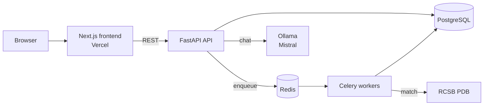

<div align="center">

# 🧬 BetaFold

**Protein structure analysis in your browser: sequence in, 3D structure, mutation insights and an AI biologist out.**


</div>

---

## ✨ Features

| | |
|---|---|
| 🔬 **Sequence analysis** | Matches against RCSB PDB (≥90% identity), DSSP secondary structure, PyTorch transformer fallback |
| 🧊 **3D viewer** | Interactive Mol* structure viewer |
| 🧪 **Mutation analysis** | See the effect of residue substitutions |
| 🤖 **AI assistant** | Local **Mistral via Ollama**: no API key, no rate limits, your data stays with you |
| ⚙️ **Async jobs** | Celery + Redis workers, optional email on completion |
| 🔐 **Accounts** | JWT auth with per-user job history |

## 🏗️ Architecture



| Layer | Stack |
|---|---|
| Frontend | Next.js 16, React 19, Tailwind 4, Mol* |
| API | FastAPI, SQLAlchemy, gunicorn + uvicorn |
| Workers | Celery + Redis |
| Database | PostgreSQL (SQLite for local dev) |
| LLM | Ollama (`mistral` by default, configurable) |

## 🚀 Quick start (Docker, everything local)

```bash
cp .env.example .env                       # set SECRET_KEY
docker compose up --build -d
docker compose exec ollama ollama pull mistral   # one-time model download (~4 GB)
```

- App: http://localhost:3000
- API docs: http://localhost:8000/docs

## 💻 Local development

```bash
# 1. LLM
ollama pull mistral && ollama serve

# 2. backend
cd backend
pip install -r requirements.txt
uvicorn main:app --reload                                 # SQLite by default
celery -A worker.celery_app worker --loglevel=info        # needs Redis on :6379

# 3. frontend
cd frontend
npm install
npm run dev
```

## ☁️ Deploying

Vercel hosts the **frontend only**. The API, Celery workers, Redis, Postgres and Ollama are long-running services that can't run on Vercel's serverless platform, so they go on a server.

### 1. Backend + Ollama on a server (VPS, Railway, Render, Fly…)

```bash
git clone https://github.com/anonymousproxi/Betafold && cd Betafold
cp .env.example .env     # set SECRET_KEY, CORS_ORIGINS=https://<your-app>.vercel.app
docker compose up -d --build api worker db redis ollama
docker compose exec ollama ollama pull mistral
```

Put the API behind HTTPS (Caddy/Nginx or your host's TLS). Mistral 7B wants ~8 GB RAM, or a GPU for fast replies. Use `OLLAMA_MODEL=phi3` or `llama3.2:3b` on small machines.

### 2. Frontend on Vercel

1. Import the repo in Vercel and set **Root Directory** to `frontend`.
2. Add environment variable `NEXT_PUBLIC_API_URL=https://<your-api-domain>`.
3. Deploy.

### Running the LLM from your own PC instead

Run `ollama serve` locally and expose the API with a tunnel (e.g. `cloudflared tunnel --url http://localhost:8000`). Free and unlimited, but only available while your PC is on.

## 🔧 Configuration

| Variable | Purpose | Default |
|---|---|---|
| `SECRET_KEY` | JWT signing key (**required in production**) | `changeme` |
| `DATABASE_URL` | SQLAlchemy URL | `sqlite:///./betafold.db` |
| `REDIS_URL` | Celery broker/backend | `redis://localhost:6379/0` |
| `OLLAMA_BASE_URL` | Ollama server | `http://localhost:11434` |
| `OLLAMA_MODEL` | Model name | `mistral` |
| `RESEND_API_KEY` | Completion emails (optional; logged if unset) | – |
| `CORS_ORIGINS` | Comma-separated allowed origins | `http://localhost:3000` |
| `FRONTEND_URL` | Link used in emails | `http://localhost:3000` |
| `NEXT_PUBLIC_API_URL` | API URL for the frontend (build-time) | `http://localhost:8000` |

## 📈 Scaling

- API is stateless: add replicas behind a load balancer, tune `gunicorn -w`
- Analysis jobs: `docker compose up -d --scale worker=N`
- Postgres with connection pooling; `user_id` indexed
- Swap the Ollama host or model via env vars without code changes

## 📁 Project structure

```
backend/    FastAPI app, Celery worker, predictor, ML model
frontend/   Next.js app (dashboard, predict, results, mutations, docs)
docker-compose.yml
.env.example
```

## 📄 License

No license has been chosen yet. All rights reserved until one is added.
